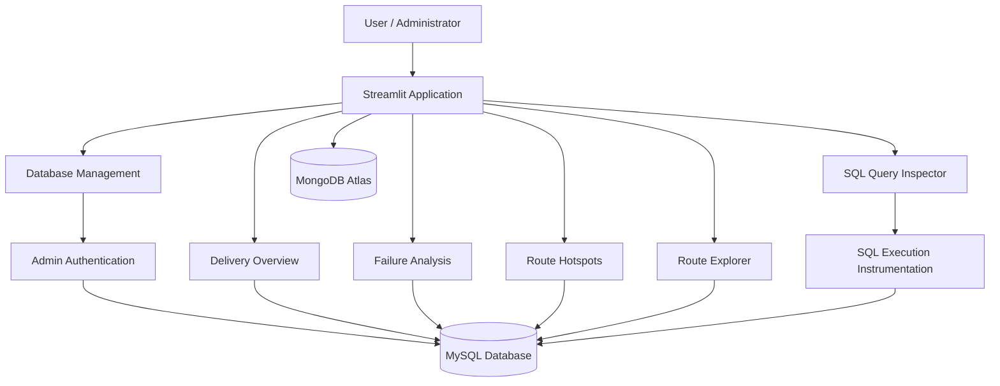

# 🚚 RouteSense — Delivery Intelligence & Route Risk Analysis

**RouteSense** is a database-driven delivery intelligence platform that helps analyze last-mile delivery performance, identify recurring delivery failures, explore route-level risk, and inspect the SQL operations behind an interactive analytics application.

Built with **Python, Streamlit, MySQL, and MongoDB**, the project combines relational data management, delivery analytics, and a practical interface for exploring and maintaining delivery records.

The project demonstrates how database systems can support operational analytics through SQL queries, relational integrity, CRUD operations, and transparent query execution.

---

## Overview

Last-mile delivery systems generate information about orders, delivery attempts, routes, drivers, vehicles, delays, and failures. Without a structured way to analyze this information, identifying recurring problems and maintaining consistent records can become difficult.

RouteSense brings these capabilities together in one application. Users can explore delivery analytics through an interactive dashboard, while authorized administrators can manage records in MySQL and inspect the SQL statements executed by the application.

## Features

### 📊 Delivery Overview
- Displays total delivery attempts, delivered attempts, failed attempts, and failure rate.
- Presents a consolidated view of delivery performance.
- Uses SQL-backed analytics for the core delivery metrics.

### 🔎 Failure Analysis
- Analyzes unsuccessful delivery attempts and their recorded reasons.
- Supports investigation of recurring failure patterns.
- Provides hourly failure analysis where the available data supports it.

### 📍 Route Hotspots
- Helps identify routes or areas associated with delivery problems.
- Supports investigation of recurring operational risks using available route and delivery data.

### 🗺️ Route Explorer
- Allows users to explore route-related information.
- Presents associated metadata to support route-level investigation.

### 🗄️ Database Management — CRUD
Authorized administrators can perform the four fundamental database operations:

| Operation | Purpose |
|---|---|
| Create | Add new records |
| Read | Search, filter, and inspect existing records |
| Update | Modify selected records |
| Delete | Remove a selected record after confirmation |

The interface validates user input and uses parameterized SQL queries to interact with MySQL. Database constraints are respected rather than bypassed to force an operation to succeed.

### 🧾 SQL Query Inspector
The SQL Query Inspector makes database operations easier to understand during development, debugging, and academic evaluation.

It displays information about SQL statements executed by the application, including:
- SQL templates.
- Bound parameters, subject to redaction.
- Operation status.
- Execution duration.
- Rows returned or affected, where available.
- Relevant errors after sensitive information has been removed.

The Inspector is read-only: it displays queries executed by the application and does not provide an arbitrary SQL execution console. Query history is designed to be isolated by Streamlit session.

### 🔐 Administrative Access
The Database Management page is protected by an administrator-password gate configured through Streamlit secrets or environment variables.

The application fails closed when the required password configuration is missing. The password is not intended to be stored in application session state or committed to the repository.

### 🍃 MongoDB Integration
MongoDB Atlas provides the application's separate NoSQL data integration for delivery-event analytics. MongoDB event records and relational delivery attempts are reported separately where their record counts represent different things.

### 🛡️ Database Connection and Error Handling
- Supports MySQL connection configuration through environment variables or Streamlit secrets.
- Supports verified TLS configuration for compatible remote MySQL hosting.
- Provides connection-status information and graceful error handling where supported.
- Keeps database credentials outside the public source repository.

---

## Technology Stack

| Technology | Purpose |
|---|---|
| Python | Application logic, data handling, and database integration |
| Streamlit | Interactive web application |
| MySQL | Relational database and CRUD operations |
| MongoDB Atlas | NoSQL event-data integration |
| `mysql-connector-python` | MySQL connectivity |
| Pandas | Data processing and analytical tables |
| PyMongo | MongoDB connectivity |
| Pytest | Automated testing |
| Git and GitHub | Version control and source management |
| Streamlit Community Cloud | Application hosting |
| Aiven MySQL | Remote MySQL hosting |

Exact package versions and development dependencies are defined in the repository's requirements files.

---

## Architecture



The Streamlit application provides the user interface. MySQL handles relational records and SQL-backed analytics, while MongoDB Atlas remains a separate data source for event-related functionality.

Database Management is restricted to authenticated administrators. The SQL Query Inspector displays application-generated SQL execution information rather than allowing arbitrary SQL submissions.

---

## Database Design

RouteSense's relational model uses six core tables.

| Table | Purpose |
|---|---|
| `customers` | Customer records associated with orders |
| `orders` | Order and delivery-related information |
| `delivery_attempts` | Individual delivery attempts, statuses, failures, and delays |
| `routes` | Route-related information |
| `drivers` | Driver information |
| `vehicles` | Vehicle information |

The schema uses primary keys, foreign keys, suitable data types, and other constraints to maintain relational integrity.

The precise columns, keys, relationships, and status definitions are specified in `sql/schema.sql`. The SQL files in `sql/` document the database schema and analytical queries used by the project.

### Delivery Statuses

The current documented delivery-attempt source uses:

| Source status | SQL application status |
|---|---|
| `SUCCESS` | `Delivered` |
| `FAILED` | `Failed` |

These values must be mapped consistently when source files are loaded into the relational schema.

The application should use database records for its metrics instead of hardcoding expected dashboard numbers.

---

## Dataset and Data Integrity

The repository includes a compact demo dataset and permitted synthetic source data for reproducibility and testing.

- `data/demo/` contains the compact relational demo dataset.
- `data/synthetic/` contains the bundled synthetic source files.
- `data/README.md` explains the available data assets and their intended use.
- `data/manifest.json` records dataset metadata and validation expectations.
- `scripts/build_demo_dataset.py` builds the demo dataset.
- `scripts/validate_data.py` checks schema consistency and supported dataset integrity rules.

The documented current full-dataset profile is:

| Table | Expected records |
|---|---:|
| `customers` | 99,441 |
| `orders` | 99,441 |
| `delivery_attempts` | 107,066 |
| `routes` | 270 |
| `drivers` | 250 |
| `vehicles` | 250 |
| **Total** | **306,718** |

For the documented delivery-attempt source, the expected status distribution is:

| Status | Records |
|---|---:|
| `SUCCESS` | 104,103 |
| `FAILED` | 2,963 |
| **Total** | **107,066** |

**These figures describe the validated full-dataset profile, not the size of the compact demo dataset.** Consult the data manifest and validation scripts to establish exactly which records are bundled in a particular repository revision.

The older database backup is not the authoritative current dataset and should not be used to replace the current source data.

Third-party data that is not included must be obtained and used in accordance with its original license, attribution requirements, and applicable privacy restrictions. The project should not redistribute private or unauthorized customer-level records.

---

## Repository Structure

```text
RouteSense-public/
├── app.py
├── src/
│   ├── auth.py
│   ├── crud.py
│   ├── database.py
│   ├── mongodb.py
│   ├── redact.py
│   ├── sql_inspector.py
│   └── tls.py
├── sql/
│   ├── schema.sql
│   ├── insert.sql
│   ├── advanced_queries.sql
│   ├── procedures.sql
│   └── reset_database.sql
├── data/
│   ├── demo/
│   ├── synthetic/
│   ├── README.md
│   └── manifest.json
├── scripts/
│   ├── build_demo_dataset.py
│   └── validate_data.py
├── tests/
├── notebooks/
├── docs/
│   └── EXCLUDED_ASSETS.md
├── .github/
│   └── workflows/
│       └── ci.yml
├── .env.example
├── .gitignore
├── requirements.txt
├── requirements-dev.txt
└── README.md
```

This describes the intended organization. Consult the repository tree for the exact contents of a particular revision.

---

## Getting Started

### Prerequisites

- Python compatible with the versions specified in the repository configuration.
- Git.
- A configured MySQL database.
- A configured MongoDB Atlas deployment if using the MongoDB-backed functionality.
- Appropriate database credentials.

### 1. Clone the repository

```bash
git clone https://github.com/ananthsyam/RouteSense-public.git
cd RouteSense-public
```

### 2. Create a virtual environment

On Windows PowerShell:

```powershell
python -m venv .venv
.\.venv\Scripts\Activate.ps1
```

On macOS or Linux:

```bash
python -m venv .venv
source .venv/bin/activate
```

### 3. Install dependencies

```bash
python -m pip install --upgrade pip
pip install -r requirements.txt
```

For development and testing, install the additional dependencies if required:

```bash
pip install -r requirements-dev.txt
```

### 4. Configure the application

Create a local `.env` file from `.env.example`:

```powershell
Copy-Item .env.example .env
```

Open `.env` and replace the example values with configuration for your own development databases.

Do not commit `.env`.

### 5. Prepare the database

Use the actual schema and data-loading instructions maintained in `sql/` and `data/README.md`.

For a disposable development database, create or select the intended database and apply `sql/schema.sql` using the database setup procedure documented by the project.

Load only an authorized dataset that matches the expected schema.

**Do not run `sql/reset_database.sql` against an existing or production database.** Any reset operation must be deliberate and limited to a disposable development environment.

### 6. Validate the available data

From the repository root:

```bash
python scripts/validate_data.py --source-targets
```

Review the validator output before using the dataset. The validator checks supported schema and dataset integrity conditions; it does not prove that an external production database is connected.

### 7. Run RouteSense locally

```bash
streamlit run app.py
```

Open the local URL printed by Streamlit, typically:

`http://localhost:8501`

---

## Configuration

The application reads database configuration from environment variables and, when deployed on Streamlit Community Cloud, the configured Streamlit secrets. The exact settings are documented in `.env.example` and the relevant source modules.

### MySQL Configuration

| Variable | Purpose |
|---|---|
| `ROUTESENSE_MYSQL_HOST` | MySQL server hostname |
| `ROUTESENSE_MYSQL_PORT` | MySQL server port |
| `ROUTESENSE_MYSQL_USER` | Database username |
| `ROUTESENSE_MYSQL_PASSWORD` | Database password |
| `ROUTESENSE_MYSQL_DATABASE` | Database name |
| `ROUTESENSE_MYSQL_SSL_CA` | Optional TLS CA configuration supported by the application |

For Aiven, use the connection details provided by the actual Aiven service and use verified TLS. Depending on the execution environment, the CA configuration may be supplied through a local certificate path or certificate content, as supported by the application's TLS helper.

Do not disable certificate verification to bypass a TLS error.

### MongoDB Atlas Configuration

| Variable | Purpose |
|---|---|
| `ROUTESENSE_ATLAS_URI` | MongoDB Atlas connection URI |
| `ROUTESENSE_ATLAS_USER` | Configured MongoDB username, where required by the connection helper |
| `ROUTESENSE_ATLAS_PASSWORD` | Configured MongoDB password, where required by the connection helper |
| `ROUTESENSE_MONGODB_DATABASE` | Optional database override |
| `ROUTESENSE_MONGODB_COLLECTION` | Optional collection override |

Use the exact configuration keys expected by `src/mongodb.py`. Do not create new credentials solely to fill optional values if the existing configuration is already correct.

### Administrator Access

The following variable protects the Database Management page:

`ROUTESENSE_ADMIN_PASSWORD`

Set a strong, unique password in the deployment's secret settings or local environment.

If the configuration is missing or empty, access to the protected management interface should remain disabled.

Do not hardcode this password into Python files or the README.

### Secrets and Environment Files

- Keep `.env` and Streamlit secret files out of Git.
- Do not publish actual database connection strings or credentials.
- Do not place passwords in screenshots, issue reports, logs, or code examples.
- Use deployment-specific secret settings rather than committing values to source control.

---

## SQL Query Inspector

The SQL Query Inspector helps developers and evaluators understand the SQL activity generated by RouteSense.

It records supported information about real application-executed database statements, such as SQL templates, execution status, duration, and row counts.

The Inspector is read-only and does not act as a general SQL console. Query history should remain session-isolated, bounded, and protected by appropriate redaction so one public visitor cannot inspect another visitor's query parameters.

---

## Testing and Development

Run the automated test suite from the repository root:

```bash
python -m pytest -q
```

Compile the application, source modules, tests, and scripts:

```bash
python -m compileall app.py src tests scripts
```

Validate the data:

```bash
python scripts/validate_data.py --source-targets
```

The project's tests cover supported functionality such as data integrity, authentication behavior, CRUD query handling, TLS configuration, and SQL Inspector isolation. Consult the actual test suite and CI results for the currently verified coverage.

Tests using mock or synthetic databases do not prove that a live Aiven or MongoDB Atlas deployment is reachable.

---

## Deployment

### Streamlit Community Cloud + Aiven MySQL

The public RouteSense application can be deployed through Streamlit Community Cloud using a GitHub repository.

The deployment requires:

1. A published version of the application code.
2. A reachable, correctly configured MySQL database.
3. Verified TLS settings for Aiven.
4. MongoDB Atlas settings where MongoDB integration is enabled.
5. The administrator password secret for CRUD access.

Configure credentials in the new app's **Secrets** settings rather than embedding them into GitHub files.

The application must use the actual Aiven endpoint and credentials in the deployed environment; local addresses and SSH tunnels are not substitutes for a remotely accessible database.

### Railway Fallback

A separate Railway deployment may be maintained as a fallback if it has its own database configuration and remains independently operational.

Changing code or configuration in one deployment does not automatically make the other deployment use the same database. Review deployment-specific settings before switching traffic or changing the primary host.

### Free-Tier Availability

Free database services may power off after periods of inactivity. A cold start or temporary database unavailability may cause the first request to fail or take longer than expected.

For demonstrations:
- Confirm that the database service is available beforehand.
- Test the public URL before presenting.
- Verify the database connection and the CRUD login separately.
- Keep an independent backup of important data.

Do not assume that a free-tier service offers uninterrupted uptime.

---

## Security and Privacy

RouteSense is designed to keep database access and secret handling separate from public source code.

Important practices include:

- Parameterized SQL for user-controlled database inputs.
- Authentication for the Database Management page.
- Explicit deletion confirmation.
- Verified TLS when using compatible remote MySQL configurations.
- Redaction of sensitive information in the SQL Inspector and error display.
- Session isolation for query history.
- Separation between public analytical views and authenticated record management.

These controls reduce risk but do not guarantee absolute security. Production use requires appropriate database privileges, credential management, monitoring, backup procedures, and regular dependency reviews.

---

## Known Limitations

- Availability depends on the configured database services and their free-tier behavior.
- The bundled demo data is not a substitute for the complete full-dataset profile.
- Full-dataset reproduction depends on having the authorized source data and following the documented setup process.
- MongoDB and MySQL have separate data models and may contain different numbers of documents and records.
- Actual connection success depends on the deployed environment's credentials, network access, and TLS configuration.

Refer to the source files and validation results for the behavior verified in a particular release.

---

## Contributing and Maintenance

Improvements should preserve database integrity, protect credentials, and include appropriate tests.

Before proposing changes:
1. Review the existing implementation and repository conventions.
2. Keep secrets, private data, and database snapshots out of commits.
3. Run the test suite and data validator.
4. Check documentation for outdated commands or mismatched schema names.
5. Verify that changes do not unintentionally affect another deployment.

---

## License and Dataset Attribution

No license is declared here by this README alone. Consult the repository's actual `LICENSE` file, if one is present, and the documentation for individual datasets before reusing or redistributing material.

Public visibility on GitHub does not by itself grant permission to reuse third-party datasets or copyrighted material. Any external dataset must be used according to its own licensing, attribution, and privacy requirements.

---

**RouteSense — Delivery Intelligence & Route Risk Analysis**

An academic database project focused on relational data, delivery performance, database operations, and transparent SQL execution.
